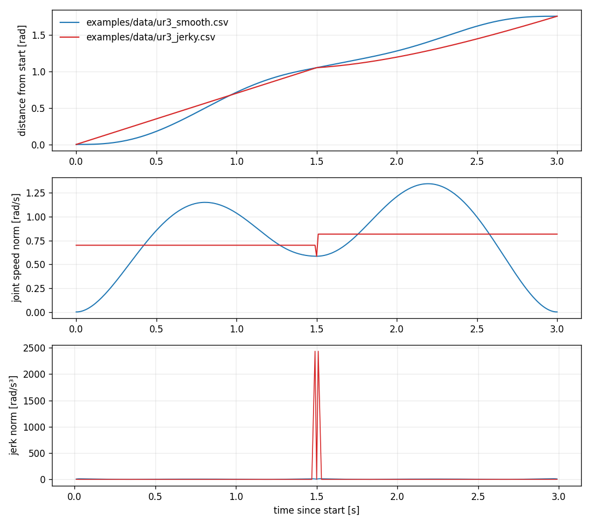
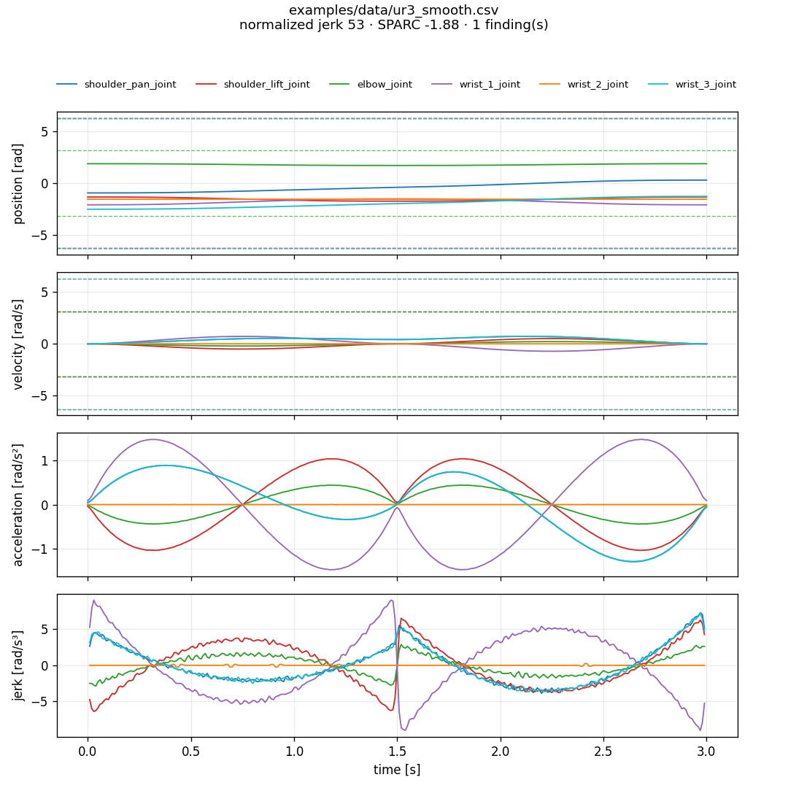
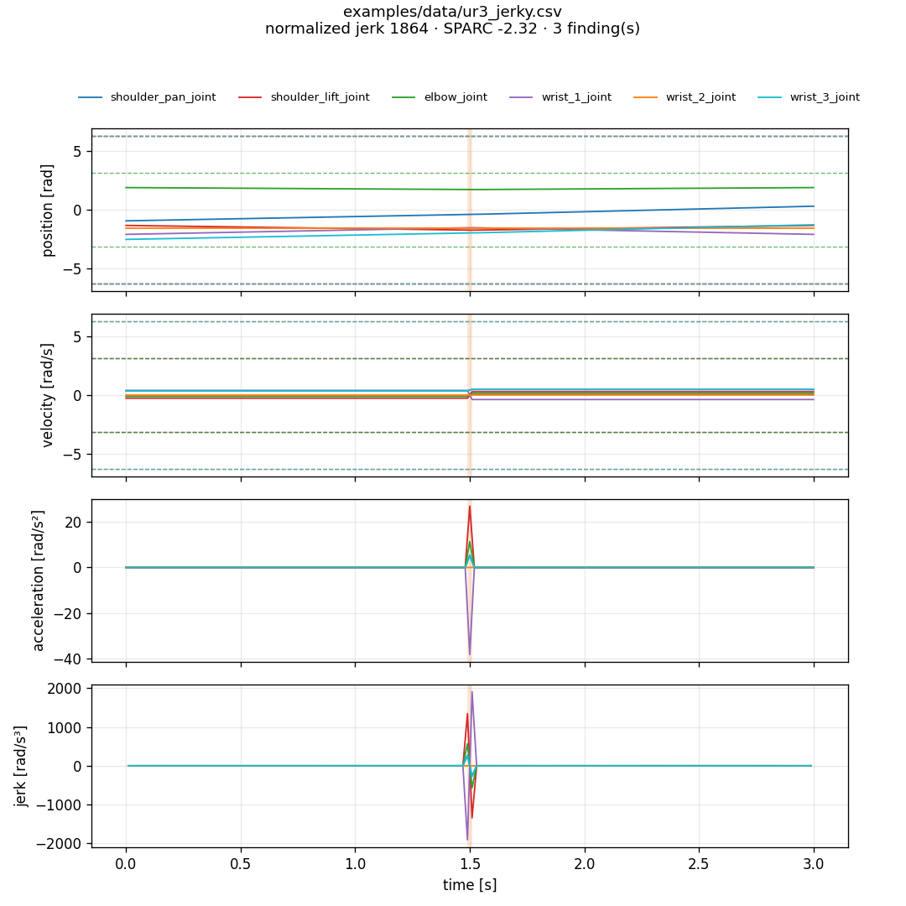
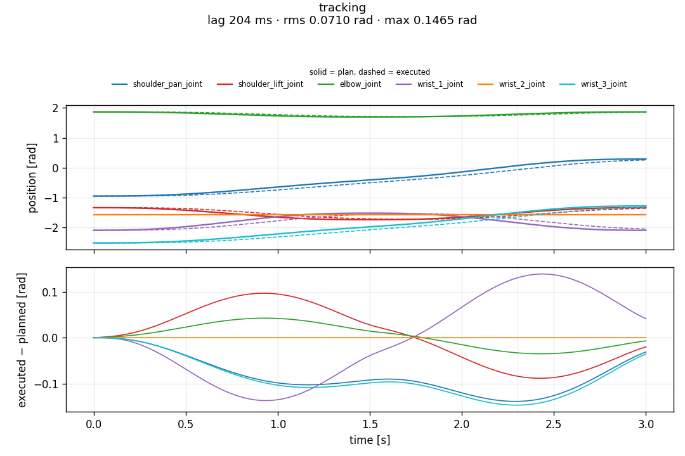
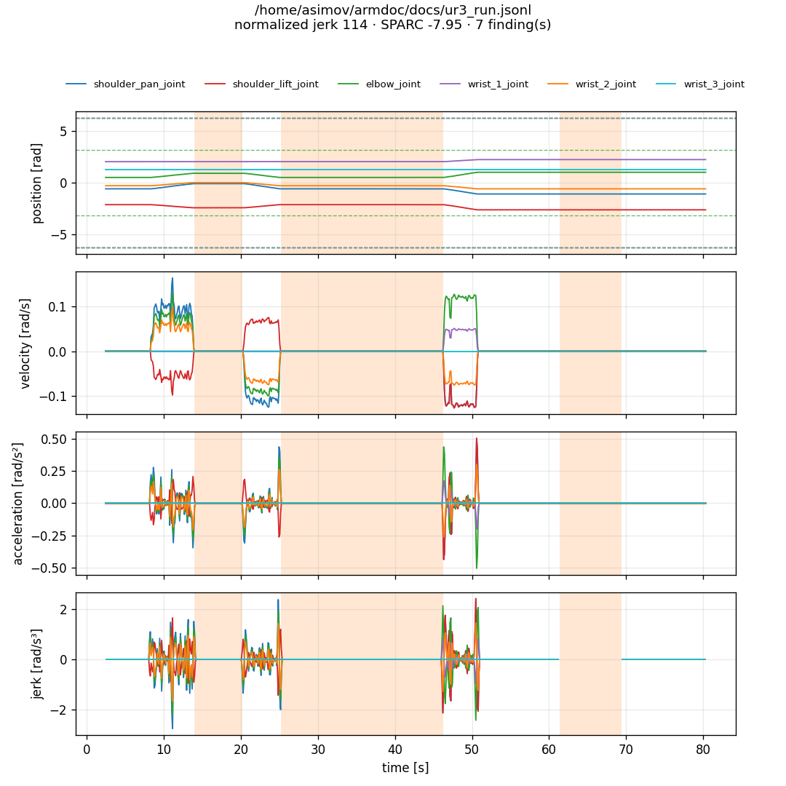

# trajlens

Quality analysis for robot arm joint trajectories, planned or executed. Give it a CSV, a `joint_trajectory` JSON, a recording or a rosbag2, and it tells you how fast, how smooth and how close to the limits the motion is, and where it goes wrong.

```
$ trajlens analyze ur3_jerky.csv --urdf ur3_limits.urdf --fk --out report.png
ur3_jerky.csv: 301 samples, 3.00s, median step 10.0 ms
  path length 2.276 rad, max joint speed 0.817 rad/s
  normalized jerk 1864.3 (min-jerk reaching = 19), SPARC -2.32
  tip path 0.480 m, tip max speed 0.177 m/s
  ...
  WARN  [JERK_SPIKE] 1 jerk spike(s), worst 2435 rad/s^3 at t=1.49s (11x the rms jerk)
  WARN  [ROUGH] normalized jerk 1864 (minimum-jerk reaching is about 19)
```

## Install

```bash
pip install .            # numpy and matplotlib
pip install ".[fk]"      # adds mujoco for tip-space metrics
```

## Speed

`pip install .` also builds an optional C++ gradient (`trajlens._fast`) when a compiler is available. It is 2.3x faster for the derivatives and 1.5x for a whole analysis of a 500,000 sample, 6 joint recording (8.0 s to 5.3 s on one core); the zero-padded FFT in the SPARC metric dominates the rest. Results match numpy to 1e-8. `TRAJLENS_NO_CPP=1` forces numpy; `trajlens.metrics.have_cpp()` tells you which one you got.

## Quick start

```bash
trajlens analyze traj.csv --urdf robot.urdf --out report.png --json metrics.json
trajlens compare a.csv b.csv --out compare.png
trajlens track planned.csv executed.csv --out track.png
trajlens --version
```

Inputs are picked by extension:

| Input | Notes |
|---|---|
| CSV | a `t` (or `time`) column plus one column per joint; without a time column pass `--rate` |
| JSON | `trajectory_msgs/JointTrajectory` as JSON (`joint_names`, `points`), `{"t": [...], "q": {...}}`, or a list of points |
| JSON lines | the [armdoc](https://github.com/darshmenon/armdoc) recording format (`{"type": "joints", "t": ..., "pos": {...}}`) |
| rosbag2 | `JointState` or `JointTrajectory` topics, only when `rosbag2_py` imports (source a ROS 2 install); otherwise trajlens says so and carries on with the other formats |

`--joints`, `--cols`, `--t0`, `--t1` and `--topic` select what to read. `trajlens analyze --strict` exits 1 on a warning or error, so it can gate a CI job.

## What it measures

- Per joint: max velocity, acceleration and jerk (finite differences on the real timestamps, per gap-free segment), range, path length, velocity use against the URDF limit, position margin as a fraction of the limit range.
- Smoothness: normalized jerk `sqrt(0.5 ∫|jerk|² dt · T⁵ / L²)` per movement (a minimum-jerk reach scores 19), and SPARC (spectral arc length of the speed profile, closer to 0 is smoother).
- Time ratio: moving time divided by the fastest the velocity limits alone would allow (a lower bound, it ignores acceleration limits).
- Joint-space path length, and with `--fk` the tip path length and tip speed from MuJoCo forward kinematics of the UR3 (`--xml`, `TRAJLENS_UR3_XML`, or `TRAJLENS_MODELS/ur3/ur3.xml`).
- Tracking: lag (shift of the executed record that minimizes the error, ±1 s at 1 ms), error with and without the lag, final pose error.
- `--smooth N` applies an N-sample moving average before differentiating, for noisy recorded data.

## Findings

| Code | Meaning |
|---|---|
| `LIMIT_EXCEEDED`, `LIMIT_NEAR` | position outside or within 2% of the URDF range of a limit |
| `VEL_OVER`, `ACC_OVER`, `JERK_OVER` | above the URDF velocity limit, or `--acc-limit` / `--jerk-limit` |
| `JERK_SPIKE` | a jerk peak more than 6x the rms jerk, typically a velocity jump at a waypoint |
| `ROUGH` | normalized jerk above 100 |
| `STOP_START` | the arm rests for 0.1 s or more between two movements |
| `SAMPLING_GAP` | a sampling step more than 10x the median |
| `SLOW_PROFILE` | moving time more than 3x the velocity-limit bound (info) |
| `FEW_SAMPLES` | fewer than 20 samples |
| `TRACKING_LAG`, `TRACKING_ERROR`, `TRACKING_FINAL`, `EXEC_ENDS_EARLY` | executed against planned |

Every finding carries a hint in the JSON output.

## Example: UR3 in MuJoCo

`examples/make_ur3_examples.py` plans one move through three tool poses on the UR3 (inverse kinematics from [reachlens](https://github.com/darshmenon/reachlens), used only by this script) twice: a C2 quintic through the via point, and a piecewise-linear constant-velocity move that jumps in velocity at the via point. It then runs both through the MuJoCo position actuators of the UR3 model at 100 Hz to get the executed motion. The CSVs are in `examples/data/`.

```bash
trajlens compare examples/data/ur3_smooth.csv examples/data/ur3_jerky.csv --urdf examples/ur3_limits.urdf --fk --out docs/compare.png
```



| | smooth | jerky |
|---|---|---|
| max jerk norm [rad/s³] | 15 | 2435 |
| normalized jerk | 53 | 1864 |
| SPARC | -1.88 | -2.32 |
| findings | none above info | `JERK_SPIKE`, `ROUGH` |

The smooth plan scores 53 and not 19 because it is one movement with a via point and no rest in between, so it is not a rest-to-rest reach. Both plans cover the same tool path (0.48 m).





### Tracking

The same plans against what the UR3 position actuators did:

```bash
trajlens track examples/data/ur3_smooth.csv examples/data/ur3_smooth_executed.csv --out docs/track_smooth.png
```



The executed motion lags the plan by about 204 ms in both cases. Removing that lag drops the rms error from 0.071 to 0.012 rad, which says the error is mostly lag and not a wrong path. The jerky plan also ends 0.010 rad off, right at the final-pose limit.

### A real recording

`trajlens analyze ~/armdoc/docs/ur3_run.jsonl` on a recording of the UR3 in Gazebo made with armdoc (10 Hz, about 78 s, three separate moves):



It flags the two long rests between the moves (`STOP_START`) and an 8 s hole in the recording (`SAMPLING_GAP`).

## Limits of the method

- Jerk is a third finite difference. On sampled or noisy data it is noisy, and for a trajectory with a velocity jump it depends on the sample rate: a jump is one sample wide, so the 100 Hz jerk peak of the jerky example is a property of the sampling, not of the robot. Use `--smooth` on measured data and compare numbers only between trajectories sampled at similar rates.
- The normalized jerk of a minimum-jerk reach converges to 19 as sampling gets finer (18.3 at 201 samples, 18.8 at 1001).
- The `SLOW_PROFILE` bound uses velocity limits only.
- The "executed" example comes from MuJoCo's position actuators, not from a real arm.
- Tip-space metrics need MuJoCo and the UR3 model; other arms are not wired up.

## Tests

```bash
pip install ".[test]"
pytest
```

## License

Apache-2.0
